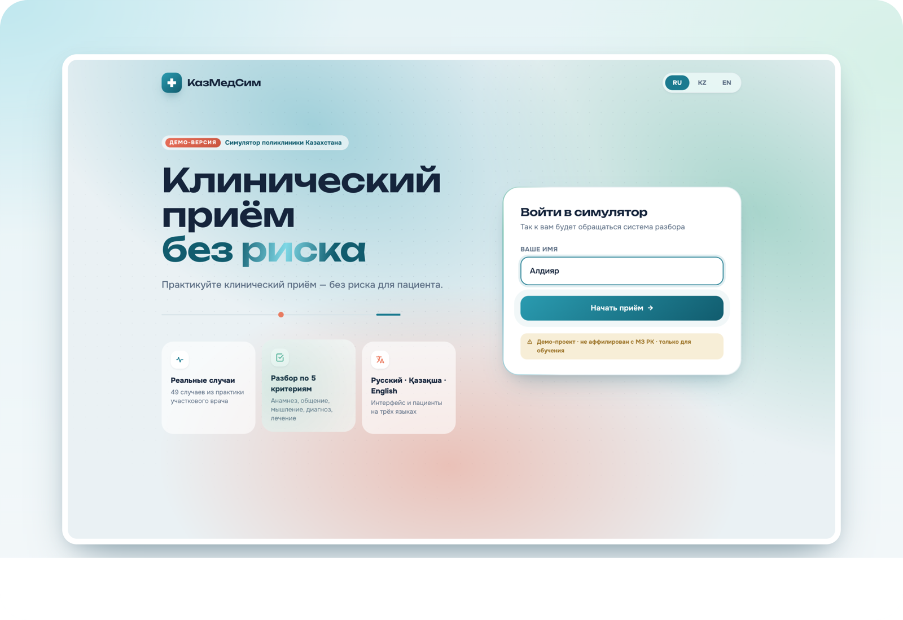
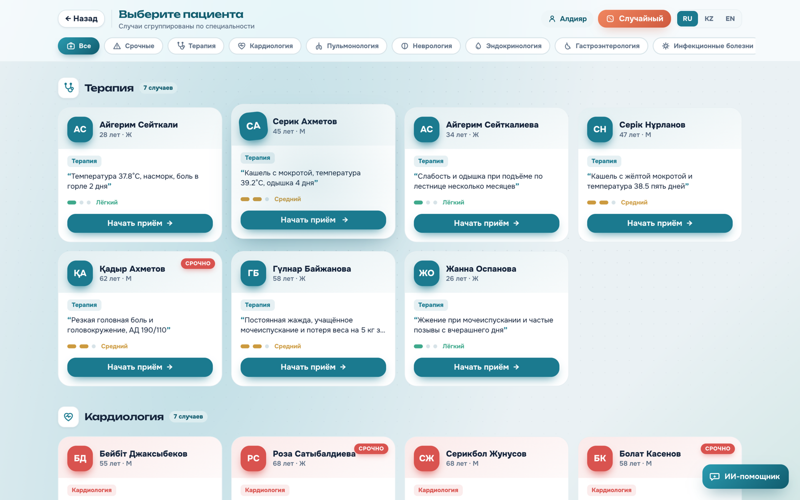
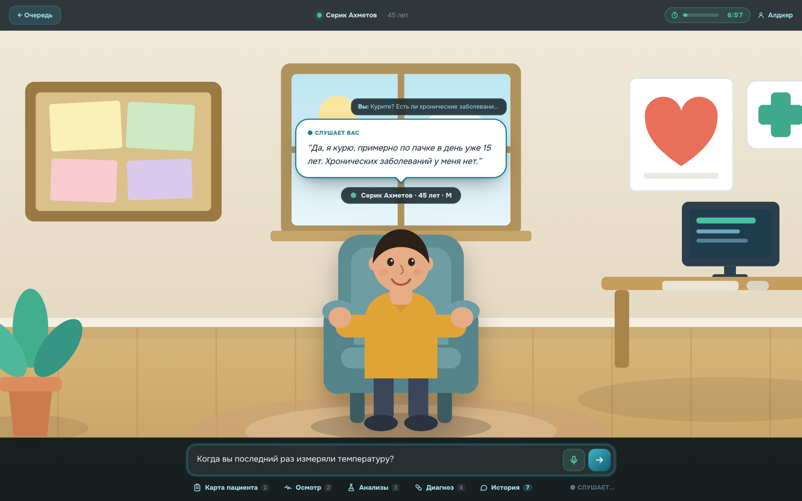
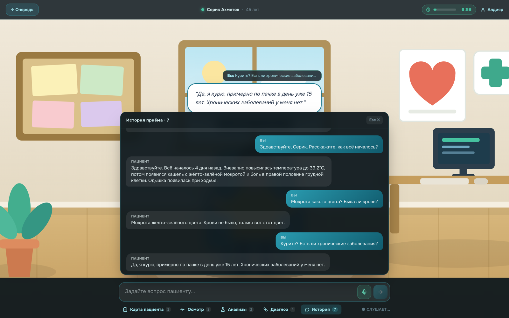
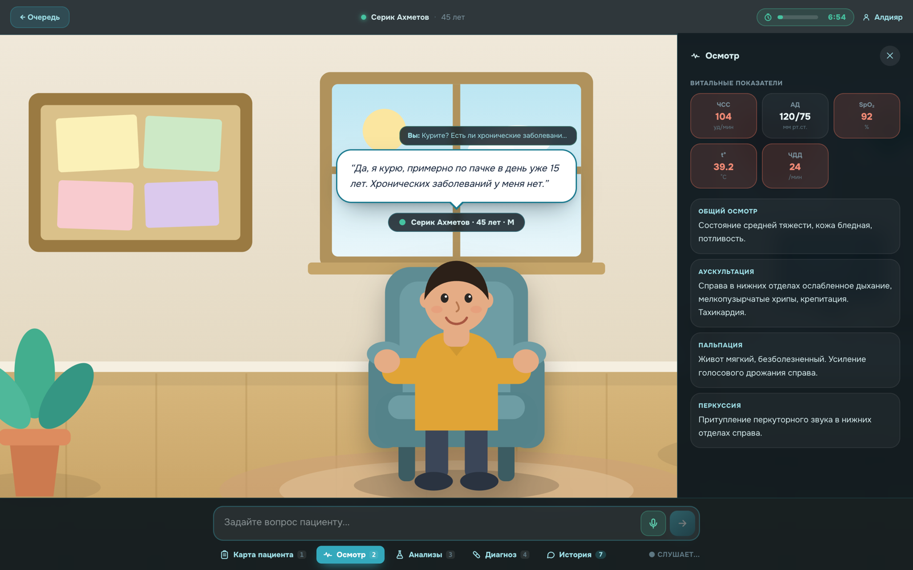
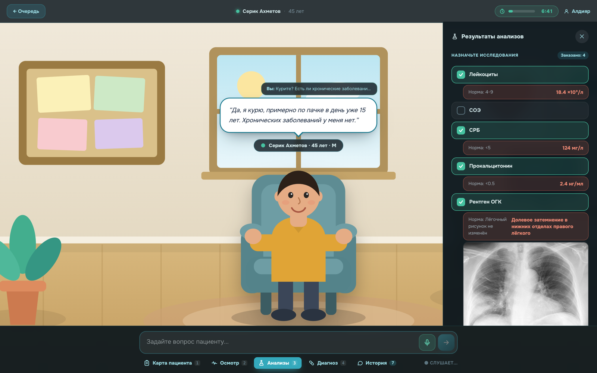
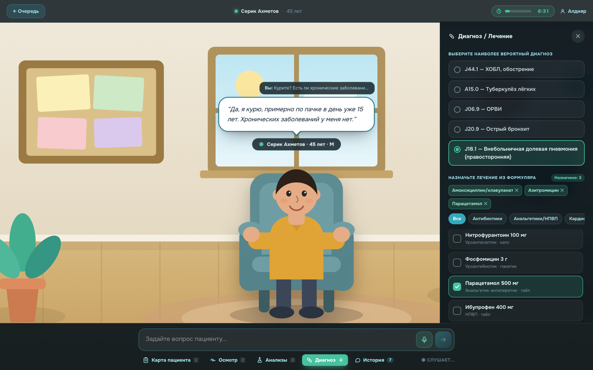
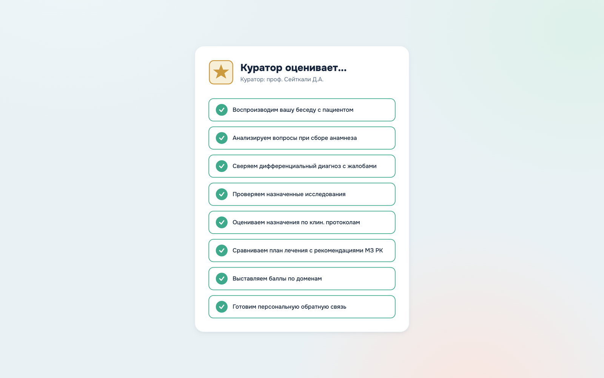
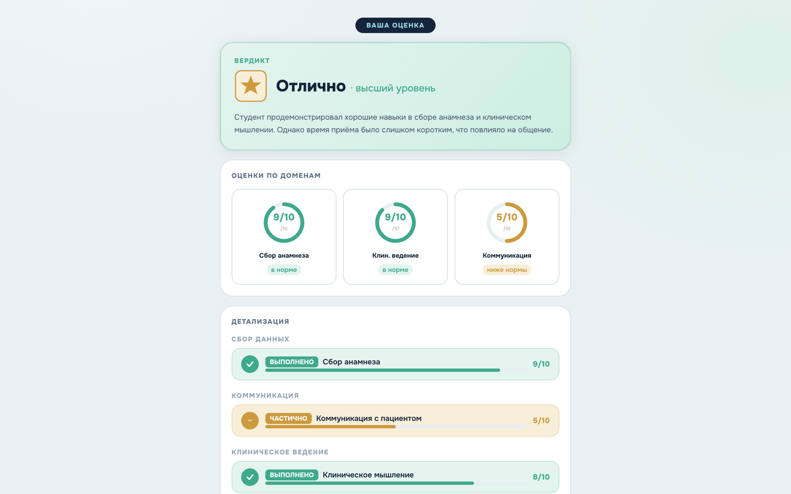
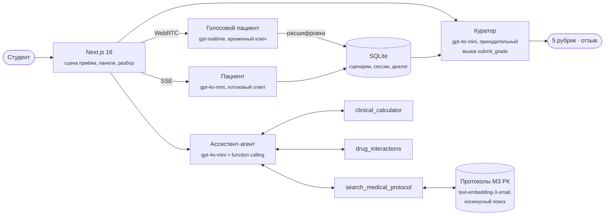

<div align="center">

# КазМедСим · KazMedSim

**Симулятор поликлиники для студентов-медиков Казахстана: живой ИИ-пациент, осмотр, анализы, диагноз и разбор от ИИ-куратора.**<br>
Студент ведёт приём текстом или голосом, назначает исследования и лечение, а куратор оценивает приём по 5 рубрикам с опорой на клинические протоколы МЗ РК.


**[▶ Открыть демо](https://frontend-production-360e3.up.railway.app)**

</div>

[Деплой](docs/DEPLOY.md) · [Eval-набор куратора](evals/README.md) · [Протоколы для RAG](docs/protocols/README.md)



## Проблема за 20 секунд

Студент медвуза до ординатуры почти не ведёт приём сам. Сбор анамнеза, выбор нужных анализов и план лечения отрабатываются на разборах «по бумаге», где нет живого пациента, нет таймера и нет обратной связи по каждому шагу. Ошибка на реальном приёме стоит дорого, а тренироваться на реальных пациентах нельзя.

**КазМедСим** — тренажёр клинического приёма участкового врача. Пациент отвечает как человек: рассказывает только то, о чём спросили, может волноваться и не знает медицинских терминов. Анализы приходят только назначенные, среди них есть лишние «ловушки». В конце ИИ-куратор разбирает приём по 5 рубрикам и объясняет, что было хорошо и что исправить.

## Что умеет

### 1. Очередь пациентов

49 случаев из практики поликлиники, по 7 в каждой из семи специальностей: терапия, кардиология, пульмонология, неврология, эндокринология, гастроэнтерология, инфекционные болезни. У каждого случая есть сложность и срочность. Правильный диагноз до конца приёма не виден: API отдаёт только публичные поля сценария.



### 2. Приём: ИИ-пациент текстом или голосом

Пациент отвечает по своей легенде: жалобы, анамнез, привычки, тревоги. Ответ приходит потоком по SSE и печатается по мере генерации. Кнопка 🎤 открывает голосовой разговор через WebRTC и OpenAI Realtime: эхо подавляется, пока говорит пациент, микрофон приглушается, а расшифровка обеих сторон сохраняется для оценки.

Вся переписка доступна в панели «История». Горячие клавиши: `/` — ввод, `1`–`4` — инструменты, `H` — история, `V` — голос, `Esc` — закрыть.

<table>
<tr>
<td width="50%"></td>
<td width="50%"></td>
</tr>
<tr>
<td align="center"><sub>Пациент отвечает на вопрос о курении; над репликой — последний вопрос врача</sub></td>
<td align="center"><sub>Панель «История»: весь диалог в один клик</sub></td>
</tr>
</table>

### 3. Осмотр, анализы и диагноз

- **Осмотр:** витальные показатели (ЧСС, АД, SpO₂, температура, ЧДД) с подсветкой отклонений, плюс общий осмотр, аускультация, пальпация и перкуссия для каждого случая.
- **Анализы:** студент сам выбирает исследования из перемешанного списка, где есть лишние и избыточные тесты (МРТ всего тела, ПЭТ-КТ, онкомаркеры). Результаты приходят с нормой и отклонением, рентген и ЭКГ — со снимком. Лишние назначения и пропуски куратор учитывает.
- **Диагноз и лечение:** выбор диагноза с кодом МКБ-10 из правдоподобных вариантов и назначение лечения из формуляра на 51 препарат, сгруппированного по классам.

<table>
<tr>
<td width="33%"></td>
<td width="33%"></td>
<td width="33%"></td>
</tr>
<tr>
<td align="center"><sub>Витальные показатели и физикальный осмотр</sub></td>
<td align="center"><sub>Назначенные анализы и рентген ОГК</sub></td>
<td align="center"><sub>Диагноз J18.1 и лечение из формуляра</sub></td>
</tr>
</table>

### 4. Разбор от ИИ-куратора

После завершения куратор оценивает приём по 5 рубрикам, каждая от 0 до 10:

1. сбор анамнеза;
2. общение с пациентом;
3. клиническое мышление (включая лишние и пропущенные анализы);
4. точность диагноза;
5. адекватность лечения.

Учитывается и время приёма: целевое окно — 8 минут. Слишком короткий приём означает поверхностный анамнез, слишком длинный — неэффективную консультацию. По каждой рубрике куратор пишет, что получилось и что улучшить, на языке студента.

<table>
<tr>
<td width="50%"></td>
<td width="50%"></td>
</tr>
<tr>
<td align="center"><sub>Шаги проверки, пока куратор оценивает</sub></td>
<td align="center"><sub>Вердикт, оценки по доменам и детализация</sub></td>
</tr>
</table>

### 5. ИИ-ассистент с инструментами

На странице пациентов есть плавающий чат-ассистент. Это агент с function calling, который не отвечает «по памяти», а вызывает детерминированные инструменты. Под ответом видно, какие инструменты он использовал.

| Инструмент | Что делает |
|---|---|
| `search_medical_protocol(condition)` | Гибридный поиск: RAG по 2 586 фрагментам 19 протоколов МЗ РК, затем поиск по базе сценариев, затем каталог неотложных состояний (анафилаксия, СЛР, септический шок, ОДСН, ОПП) |
| `clinical_calculator(name, params)` | 5 шкал: CHA₂DS₂-VASc, Wells (ТГВ), qSOFA, eGFR (CKD-EPI 2021), HEART |
| `drug_interactions(drugs)` | Попарные взаимодействия по каталогу из 27 пар с учётом классов (варфарин × НПВП, статин × макролид и др.) |

## Как это устроено



- **Структурированная оценка.** Куратор не пишет свободный markdown, который «плывёт» между языками. Модель обязана вызвать инструмент `submit_grade` (`tool_choice` принудительный) со схемой: оценка, «что хорошо» и «что улучшить» по каждой рубрике, итог и рекомендация. Текст отзыва собирается из этих полей в коде.
- **Кэширование промптов.** Статичная часть (легенда пациента, правила рубрик) стоит в начале промпта, поэтому OpenAI автоматически кэширует общий префикс между вызовами. Токены, стоимость и попадания в кэш каждого вызова пишутся в `db/events.jsonl`, сводку строит `scripts/telemetry_summary.py`.
- **RAG по протоколам.** 19 официальных PDF (около 620 страниц) разбиты на фрагменты PyMuPDF, проиндексированы `text-embedding-3-small` и хранятся прямо в SQLite. Поиск — косинусное сходство в памяти, без отдельной векторной БД.
- **Голос без ключа в браузере.** Бэкенд выдаёт короткоживущий `client_secret` OpenAI Realtime, а браузер соединяется с моделью напрямую по WebRTC.
- **Студент не видит ответ заранее.** Список сценариев и старт сессии отдают только публичные поля, правильный диагноз и эталон лечения остаются на сервере до оценки.
- **Три языка целиком.** Интерфейс, легенды пациентов, промпты (пациент, куратор, ассистент × ru/kk/en) и отзыв куратора существуют на русском, казахском и английском.

## Проверка качества

Оценки LLM шумные, поэтому куратор покрыт регрессионным набором `evals/`: 5 вручную составленных приёмов (хорошие и плохие) с ожидаемыми диапазонами баллов по каждой рубрике. Цель — не угадать точный балл, а поймать качественную регрессию: если правка промпта начнёт поощрять плохой анамнез или штрафовать верный диагноз, прогон упадёт.

```bash
.venv/bin/python -m evals.run            # все фикстуры параллельно
.venv/bin/python -m evals.run -k pneumon # по подстроке имени
.venv/bin/python -m evals.run -v         # с отзывом куратора для упавших
```

Код возврата 0, если всё прошло, иначе 1 — готово для CI.

> **Честно о границах.** 5 фикстур — маленький набор, он ловит грубые регрессии, но не гарантирует точность оценки на любом приёме. Клинические случаи синтетические, хотя сверены с протоколами МЗ РК. Это учебный тренажёр, а не клиническая система.

## Стек

| Слой | Технологии |
|---|---|
| Фронтенд | Next.js 16 (App Router), React 19, TypeScript, Tailwind CSS 4, Motion |
| Бэкенд | FastAPI, Uvicorn, Python 3.12+, Server-Sent Events |
| Пациент, куратор, ассистент | OpenAI `gpt-4o-mini` (function calling) |
| Голосовой режим | OpenAI `gpt-realtime` по WebRTC |
| RAG | `text-embedding-3-small`, PyMuPDF, косинусный поиск в памяти |
| Данные | SQLite: сценарии, сессии, диалоги, фрагменты протоколов |
| Инфраструктура | Railway |

## Быстрый старт

```bash
# 1. Зависимости
npm install
python -m venv .venv && source .venv/bin/activate
pip install -r backend/requirements.txt

# 2. Ключи
cp .env.local.example .env.local   # впишите OPENAI_API_KEY
```

База `db/kazmedsim.db` лежит в репозитории: в ней уже 49 сценариев и индекс протоколов, сидить ничего не нужно.

```bash
# 3. Запуск, два терминала
uvicorn backend.main:app --reload --reload-dir backend   # API на :8000
npm run dev                                              # сайт на :3000
```

Откройте http://localhost:3000. Swagger API: http://localhost:8000/docs.

`--reload-dir backend` обязателен: без него uvicorn следит и за `.venv` и бесконечно перезапускается.

<details>
<summary>Пересобрать базу с нуля</summary>

```bash
python scripts/seed_db.py            # базовые сценарии
python scripts/seed_scenarios_v2.py  # ещё 35 случаев до 7 на специальность
python scripts/ingest_protocols.py   # эмбеддинги протоколов (PDF в docs/protocols/)
```

</details>

## API

```
GET  /api/scenarios?lang=ru&specialty=cardiology
POST /api/session/start      { scenario_id, student_name, language }
POST /api/session/message    { session_id, message }                → SSE-поток
GET  /api/session/{id}/labs
POST /api/session/end        { session_id, student_diagnosis, student_treatment,
                               ordered_tests, examined, elapsed_seconds }
POST /api/assistant          { messages: [{role, content}], language }
POST /api/realtime/session   { session_id }   → временный client_secret OpenAI
POST /api/session/log_turn   { session_id, role, text }   ← расшифровки голоса
```

`/api/session/message` отдаёт `text/event-stream` с событиями `data: {"delta": "..."}` и завершающим `data: {"done": true}`.

## Структура

```
backend/
  main.py              маршруты: сессии, анализы, оценка, ассистент, realtime
  grader.py            куратор: принудительный вызов submit_grade
  assistant_tools.py   3 инструмента ассистента и их схемы
  rag.py               косинусный поиск по фрагментам протоколов
  telemetry.py         токены, стоимость и кэш каждого вызова
  prompts/             промпты пациента, куратора и ассистента × ru/kk/en
db/
  schema.sql           таблицы: scenarios, sessions, dialog_log, protocol_chunks
  kazmedsim.db         SQLite со сценариями и RAG-индексом
evals/                 регрессионный набор куратора
public/labs/           рентгены и ЭКГ к результатам анализов
scripts/               сид сценариев, загрузка протоколов, переводы, сводка телеметрии
src/
  app/                 страницы: главная, вступление, пациенты, приём, разбор
  components/          ассистент, карточка пациента, голосовой режим, UI-эффекты
  lib/                 API-клиент с SSE, клинические данные и формуляр
```

## Дисклеймер

Только для обучения. Проект не аффилирован с МЗ РК. Клинические случаи синтетические и сверены с протоколами МЗ РК и международными рекомендациями, но не заменяют клиническое мышление и официальные документы.
